# Install Firebase for Flutter

> Read through the FAQ at the end of this document first. When you hit an issue during setup, check there before asking for help.

---

## 1. Create a Firebase project

If you haven't already, create an account or sign into [Firebase](https://firebase.google.com/).

Create a new Firebase project:

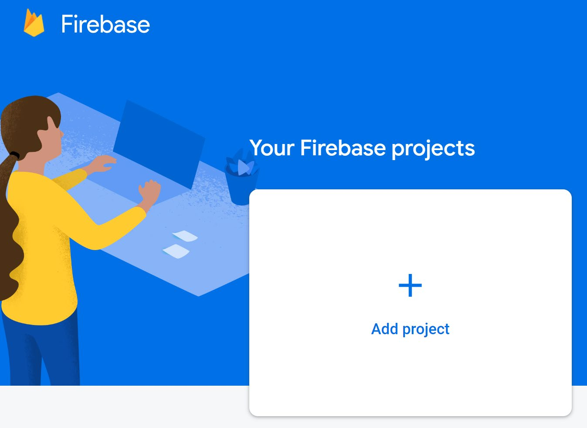

Name your project (e.g. `DMIT2504 <your-nait-username> Project`) and click **Continue**.

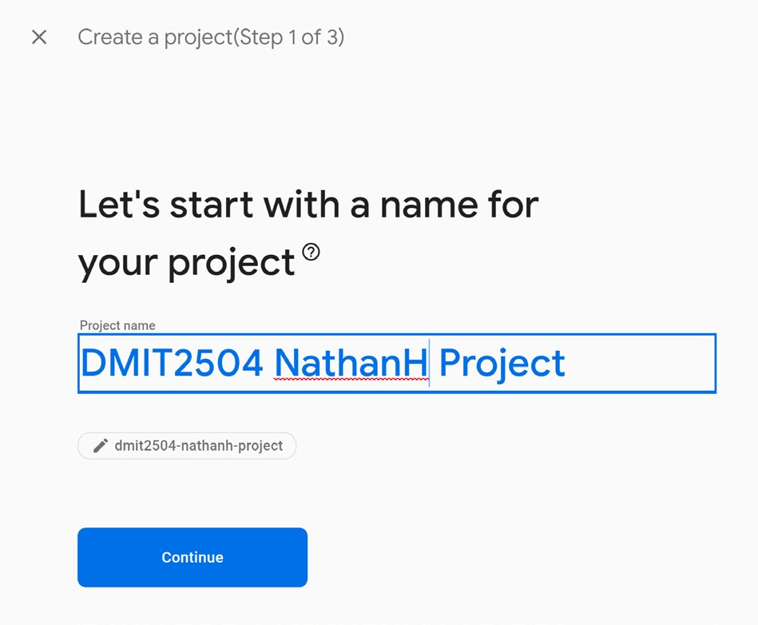

Disable Google Analytics for the project and click **Create Project**. It will take a minute. Once it's ready, click **Continue**.

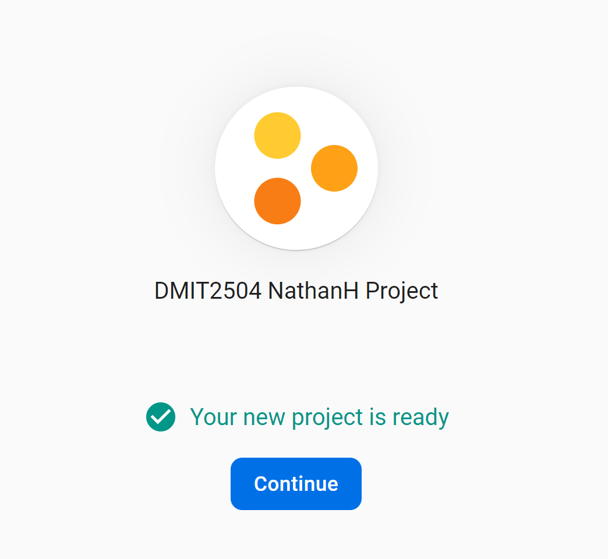

You will be brought to your project's dashboard page.

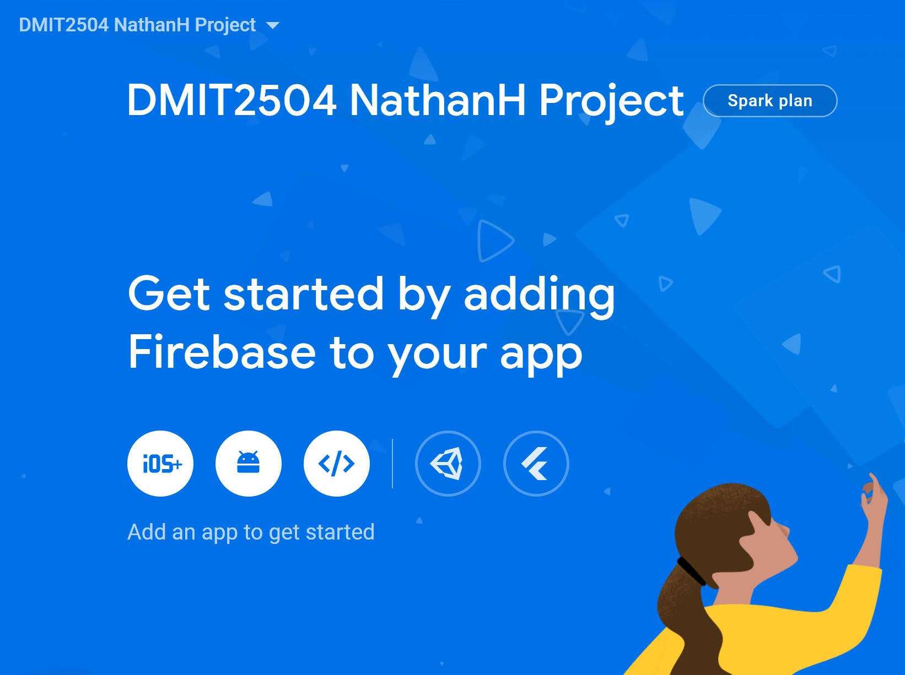

Leave this page open. You'll come back to it.

---

## 2. Install Node.js

Download and install Node.js from [nodejs.org](https://nodejs.org/).

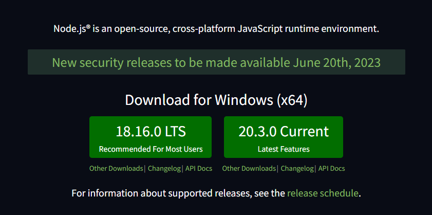

Install the **LTS** version. You don't need to install the additional build tools (e.g. Chocolatey).

---

## 3. Install the Firebase CLI

Open the terminal and install the Firebase CLI Tools using npm. See the full instructions here: [Firebase CLI reference](https://firebase.google.com/docs/cli).

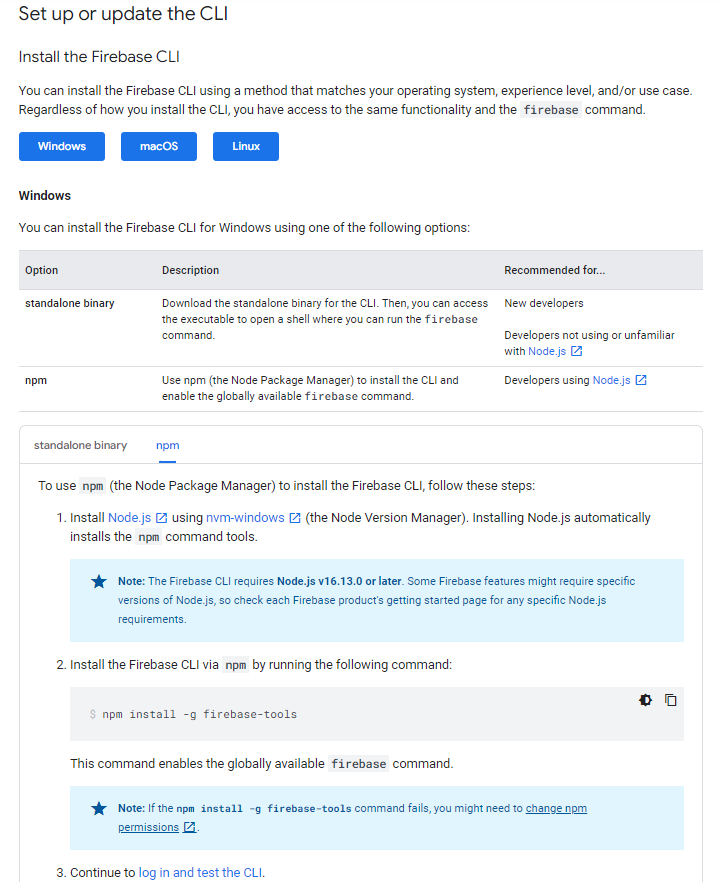

Run:

```
npm install -g firebase-tools
```

This installs the globally available `firebase` command.

---

## 4. Log in and test the CLI

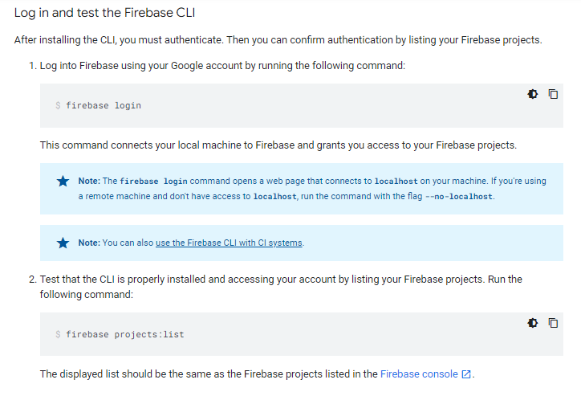

Log into Firebase:

```
firebase login
```

If you are already logged in, you will see a message in the terminal saying so. If you need to login, you will be redirected to a web browser window to sign into your account. Allow Windows Defender access if you get prompted.

Test that the CLI is installed and connected to your account by listing your projects:

```
firebase projects:list
```

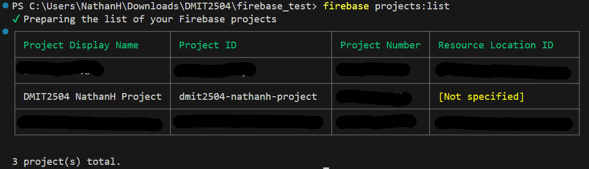

The list should include the project you just created.

---

## 5. Create a Flutter app

Create a new Flutter application in VS Code (empty application).

**Important:** Name the Flutter project the same thing as the Firebase project. This avoids confusion later. Renames are possible but messy.

Watch out for file paths with spaces or special characters -- they can cause issues with Firebase tooling.

---

## 6. Install and run the FlutterFire CLI

The FlutterFire CLI generates the configuration files that connect your Flutter app to your Firebase project.

Install it:

```
dart pub global activate flutterfire_cli
```

**Restart your terminal** after this. The PATH environment variable needs to reload to find the new `flutterfire` command.

---

## IMPORTANT

**Read traceback carefully after running this command. If you get a warning that the newly installed tools are not in your OS PATH and/or `flutterfire` commands don't work:**

- type "environment" into your Windows search bar -> "edit the system environment variables"

- hit `Environment Variables` button at bottom-right

- in the first section (user variables), find the one called `Path` and hit `Edit`

- from the new window where every directory is on its own row, hit `New`, and paste in the path from the `flutterfire` warning

- if this doesn't work, try adding it to system-level PATH (the second section in env variables) rather than the user-level PATH

---

Now configure your app. Run this from your Flutter project folder:

(On Windows, you may be stuck typing `flutterfire.bat` instead of `flutterfire` depending on whether you're in `cmd`, powershell, or a linux-like bash shell)

```
flutterfire configure
```

1. Choose your project from the list presented.
2. Only leave the **android** platform option checked (deselect everything else).

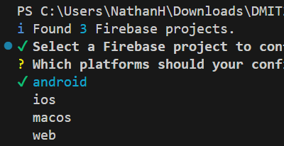

3. The tool will complete the necessary configuration steps for your project.

---

## 7. Add `firebase_core` and initialize

Add the `firebase_core` package:

```
flutter pub add firebase_core
```

You may see a message about enabling symlink support:

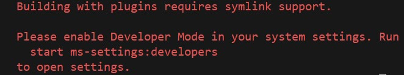

If so, run the stated command (`start ms-settings:developers`) and turn on Developer Mode:

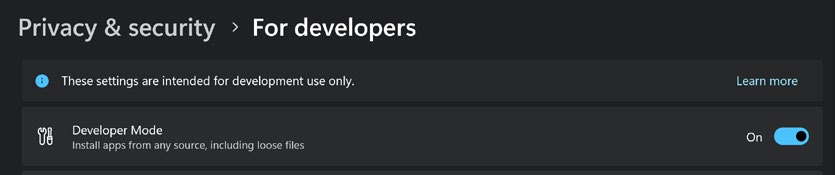

Accept the warning message (you are a developer after all!).

After enabling Developer Mode, run the configure step again to update your project:

```
flutterfire configure
```

Choose your project and ensure only the android option is selected again.

---

## 8. Initialize Firebase in `main.dart`

Add the following import statements to the top of `lib/main.dart`:

```dart
import 'package:firebase_core/firebase_core.dart';
import 'firebase_options.dart';
```

Mark your `main()` function as `async` and add the Firebase initialization before `runApp`:

```dart
Future<void> main() async {
  WidgetsFlutterBinding.ensureInitialized();

  await Firebase.initializeApp(
    options: DefaultFirebaseOptions.currentPlatform,
  );

  runApp(const MainApp());
}
```

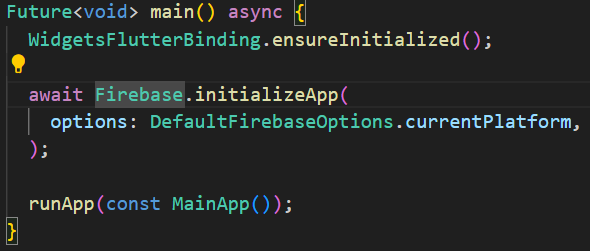

---

## 9. Run and verify

Run your app. You should see no errors -- just the Hello World message:


If it runs without errors, Firebase is connected. You're ready to start building.

The next step will be to enable Firebase Auth: [Get Started with Firebase Authentication on Flutter](https://firebase.google.com/docs/auth/flutter/start).

---

## FAQ

### "flutterfire" is not recognized as a command

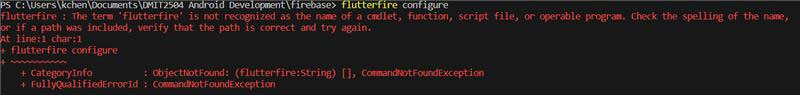

The `flutterfire` script isn't in your environment path. This can be caused by:

1. The PATH environment variable wasn't updated when the `flutterfire` package was installed.
2. The terminal window you're working in was opened before the install completed, so the PATH hasn't been reloaded.

To fix:

1. Check whether the `flutterfire` script has been added to your PATH. You should find it in `C:\Users\YourUsername\AppData\Local\Pub\Cache\bin`. If it's not listed in your PATH, add it manually (we updated the PATH environment variable in the first weeks of the term).
2. Whether the location was already listed or you just added it, **close and reopen your terminal**. If you're in VS Code, close VS Code entirely and reopen it.
3. Check your PATH by typing `$Env:Path` on the PowerShell prompt. The path to the Pub Cache bin directory should appear.

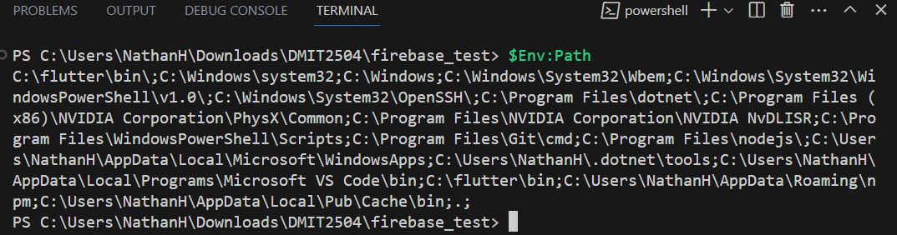

### "firebase login" gives a scripts-cannot-be-run error

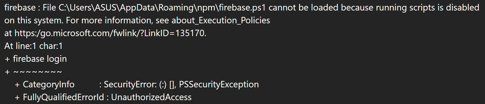

The error message says something like: `firebase.ps1 cannot be loaded because running scripts is disabled on this system`.

Run the `cmd` command from PowerShell to switch to the classic command prompt, then run `firebase login` from there. This bypasses the PowerShell execution policy issue.

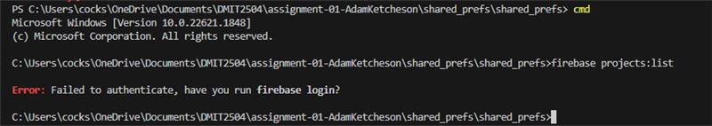

### Build fails with a minSdkVersion warning

This isn't directly a Firebase issue -- it comes up whenever you add enough plugins. Flutter defaults to a lower `minSdkVersion` for broader device support, but many plugins require a newer version.

**Quick fix for one app:** Open `android/app/build.gradle` and change the `minSdkVersion` in the `defaultConfig` line:

```groovy
minSdkVersion 23
```

(Replace `flutter.minSdkVersion` with the number, e.g. `23`.)

**Global fix for all apps:** Find your Flutter install location and open `[FlutterPath]/flutter/packages/flutter_tools/gradle/flutter.gradle`. Update the `minSdkVersion` setting there.

### Build fails with Kotlin library duplication

Add the following line to the `dependencies` section at the end of `android/app/build.gradle`:

```groovy
dependencies {
    implementation(platform("org.jetbrains.kotlin:kotlin-bom:1.8.0"))
}
```
