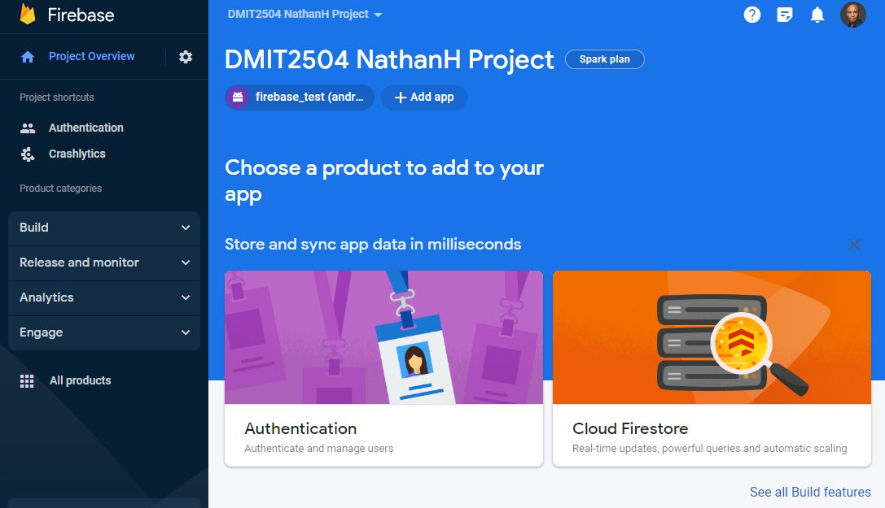
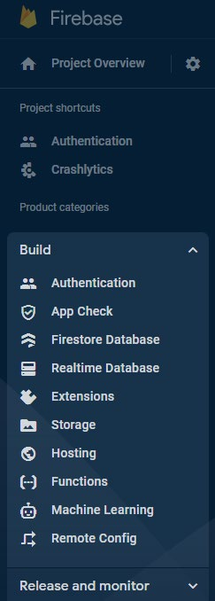
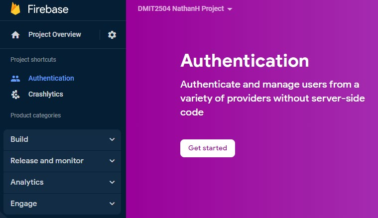
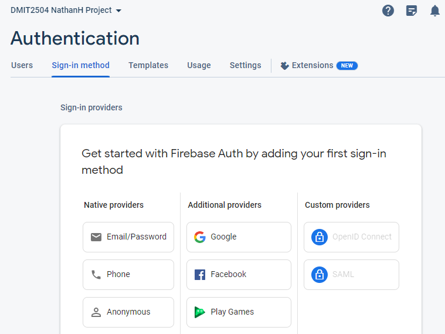
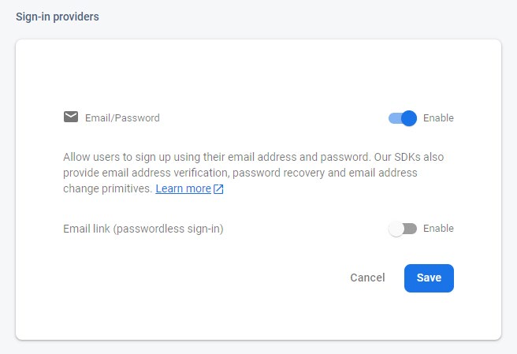
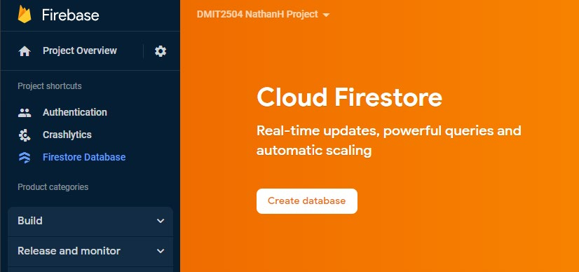
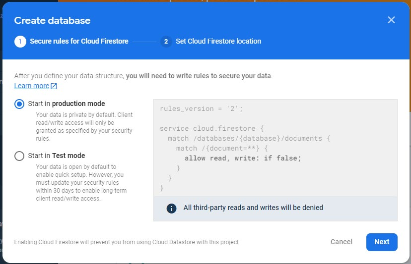
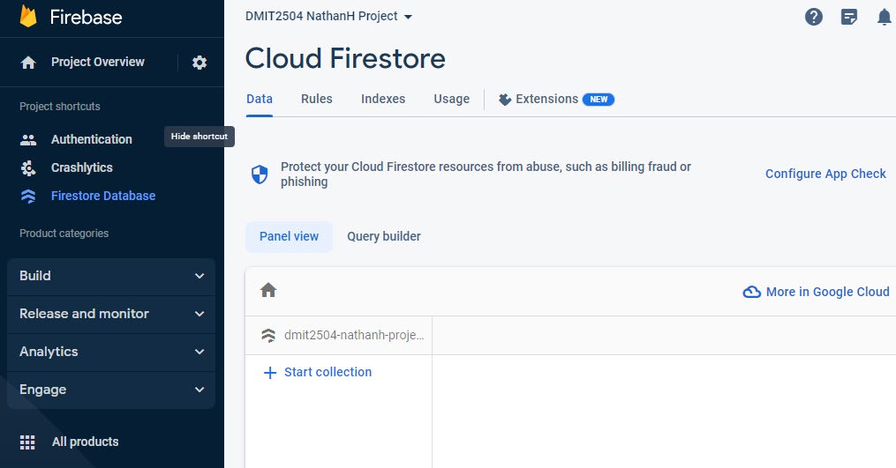

# Firebase Auth + Firestore

Now that our app is connected to Firebase, we'll learn how to talk to auth & storage.

This **does** work with browser-only emulation, so you don't have to emulate android for this example if that would drown your hardware.

We'll develop a Flutter app where users sign in with email/password (using Firebase's pre-built UI), and *only then* be able to view, check off, delete, and add todo items stored in Cloud Firestore. 

Each user will only see only their own data.


---

## Table of Contents

0. [Copy over the skeleton app](#0-copy-over-the-skeleton-app)
1. [Enable Auth & Firestore in Firebase Console](#1-enable-auth--firestore-in-firebase-console)
2. [Install Flutter Plugins](#2-install-flutter-plugins)
3. [Create ApplicationState (ChangeNotifier)](#3-create-applicationstate-changenotifier)
4. [Build the HomePage with ListenableBuilder](#4-build-the-homepage-with-listenablebuilder)
5. [Set Up Routes and Firebase UI Screens](#5-set-up-routes-and-firebase-ui-screens)
6. [Test Authentication](#6-test-authentication)
7. [Create the Todo Model](#7-create-the-todo-model)
8. [Build the Todo Page with Test Data](#8-build-the-todo-page-with-test-data)
9. [Set Firestore Security Rules](#9-set-firestore-security-rules)
10. [Wire Up Firestore to ApplicationState](#10-wire-up-firestore-to-applicationstate)
11. [Connect the Todo Page to Firestore](#11-connect-the-todo-page-to-firestore)
12. [Exercise: Add New Todos](#12-exercise-add-new-todos)
13. [FAQ / Troubleshooting](#13-faq--troubleshooting)

---

<a id="0-copy-over-the-skeleton-app"></a>
<details>
<summary><strong>0. Copy over the skeleton app from example 1 that's set up for Firebase.</strong></summary>

Use the one you wrote, since mine (in `instructor`) wire to my firebase login, not yours

</details>

---

<a id="1-enable-auth--firestore-in-firebase-console"></a>
<details>
<summary><strong>1. Enable Auth & Firestore in Firebase Console</strong></summary>

Before writing any Flutter code, we'll setup and enable Authentication and Firestore in our app/project.

### Enable Email/Password Authentication

1. Open your Firebase project in the [Firebase Console](https://console.firebase.google.com/).

   

2. In the left sidebar, click **Build**, then **Authentication**.

   

3. Click **Get started**.

   

4. You'll see a list of sign-in providers. Click **Email/Password**.

   

5. Toggle **Enable** for Email/Password. Leave "Email link (passwordless sign-in)" disabled. Click **Save**.

   

### Create Firestore Database

6. Back in the left sidebar under **Build**, click **Firestore Database**.

7. Click **Create database**.

   

8. Select **Start in production mode**. Click **Next**.

   

   > Why production mode? Test mode allows anyone to read/write your database for 30 days, then locks everything. Production mode starts with the db locked, and then you write rules to open up access to it. That is a canonically safer approach.

9. Choose **northamerica-northeast1 (Montréal)** as the Cloud Firestore location. Click **Create**.

   

   Region matters for latency and data residency. In professional settings, legal/privacy compliance regulations will be a major deciding factor too.

</details>

---

<a id="2-install-flutter-plugins"></a>
<details>
<summary><strong>2. Install Flutter Plugins</strong></summary>

Open a terminal in your Flutter project folder and install the required packages:

```bash
flutter pub add firebase_auth firebase_ui_auth cloud_firestore
```

You should already have `firebase_core` from Day 1. If not, add it too:

```bash
flutter pub add firebase_core
```

What these packages do:

| Package | Purpose |
| --- | --- |
| `firebase_core` | Initializes the Firebase connection (Day 1) |
| `firebase_auth` | Firebase authentication API |
| `firebase_ui_auth` | Pre-built sign-in and profile UI widgets |
| `cloud_firestore` | Firestore database API |

After install, your first build will be slower than usual after install, which is normal. The newly installed packages need to compile down to native code.

</details>

---

<a id="3-create-applicationstate-changenotifier"></a>
<details>
<summary><strong>3. Create ApplicationState (ChangeNotifier)</strong></summary>

We need a class that tracks whether the user is signed in and notifies the UI when that changes. This uses `ChangeNotifier`, which is Flutter's built-in mechanism for reactive state.

**Key concept:** `ChangeNotifier` gives you a method called `notifyListeners()`. When you call it, any widget watching this object will rebuild. Think of it as a simple event system: "something changed, everyone who cares should update.". It's the same basic pattern that things like push notifications are based on.

Create a new file `lib/app_state.dart`:

```dart
import 'package:firebase_auth/firebase_auth.dart' hide EmailAuthProvider;
import 'package:firebase_core/firebase_core.dart';
import 'package:firebase_ui_auth/firebase_ui_auth.dart';
import 'package:flutter/material.dart';

import 'firebase_options.dart';

class ApplicationState extends ChangeNotifier {
  ApplicationState() {
    init();
  }

  bool _loggedIn = false;
  bool get loggedIn => _loggedIn;

  Future<void> init() async {
    await Firebase.initializeApp(
      options: DefaultFirebaseOptions.currentPlatform,
    );

    FirebaseUIAuth.configureProviders([
      EmailAuthProvider(),
    ]);

    FirebaseAuth.instance.userChanges().listen((user) {
      if (user != null) {
        _loggedIn = true;
      } else {
        _loggedIn = false;
      }
      notifyListeners();
    });
  }
}
```

**What's happening here:**

- `extends ChangeNotifier`: gives us `notifyListeners()`.
- The constructor calls `init()`. We can't make a constructor `async`, so the async work lives in a separate method.
- `Firebase.initializeApp(...)`: same as your Day 1 code, just moved into this class.
- `FirebaseUIAuth.configureProviders([EmailAuthProvider()])`: tells Firebase UI which sign-in methods are available. We only enabled Email/Password.
- `userChanges().listen(...)`: a stream listener. Every time auth state changes (sign in, sign out, token refresh), this callback fires. We update `_loggedIn` and call `notifyListeners()` so the UI rebuilds.

> **Why `hide EmailAuthProvider`?** Both `firebase_auth` and `firebase_ui_auth` export a class called `EmailAuthProvider`.
We just want the one from `firebase_ui_auth`, so we hide the other to avoid a name collision.

</details>

---

<a id="4-build-the-homepage-with-listenablebuilder"></a>
<details>
<summary><strong>4. Build the HomePage with ListenableBuilder</strong></summary>

The home page needs to show different buttons depending on whether the user is signed in. `ListenableBuilder` is a widget that watches a `ChangeNotifier` and rebuilds when it fires.

Create `lib/home_page.dart`:

```dart
import 'package:firebase_test/app_state.dart';
import 'package:flutter/material.dart';

class HomePage extends StatelessWidget {
  const HomePage({required this.authAppState, super.key});

  final ApplicationState authAppState;

  @override
  Widget build(BuildContext context) {
    return Scaffold(
      appBar: AppBar(
        title: const Text('Firebase Auth Demo'),
      ),
      body: ListView(
        children: <Widget>[
          const SizedBox(height: 16.0),
          ListenableBuilder(
            listenable: authAppState,
            builder: (context, child) {
              return authAppState.loggedIn
                  ? ElevatedButton(
                      onPressed: () =>
                          Navigator.of(context).pushNamed('/profile'),
                      child: const Text('Profile'),
                    )
                  : ElevatedButton(
                      onPressed: () =>
                          Navigator.of(context).pushNamed('/sign-in'),
                      child: const Text('Sign In'),
                    );
            },
          )
        ],
      ),
    );
  }
}
```

**What's happening:**

- `ListenableBuilder` takes a `listenable:` (our `ApplicationState`) and a `builder:` function.
- When `notifyListeners()` fires inside `ApplicationState`, the builder re-runs.
- If logged in --> show "Profile" button. If not --> show "Sign In" button.
- This is a `StatelessWidget`. We don't need `setState` because `ListenableBuilder` handles the rebuilding internally.

</details>

---

<a id="5-set-up-routes-and-firebase-ui-screens"></a>
<details>
<summary><strong>5. Set Up Routes and Firebase UI Screens</strong></summary>

Firebase UI Auth gives us pre-built `SignInScreen` and `ProfileScreen` widgets. We don't have to build login forms: we just wire them into routes and handle the callbacks.

Replace your `lib/main.dart` with:

```dart
import 'package:firebase_test/app_state.dart';
import 'package:firebase_ui_auth/firebase_ui_auth.dart';
import 'package:flutter/material.dart';

import 'home_page.dart';

Future<void> main() async {
  WidgetsFlutterBinding.ensureInitialized();

  ApplicationState authAppState = ApplicationState();

  runApp(MainApp(authAppState: authAppState));
}

class MainApp extends StatelessWidget {
  const MainApp({required this.authAppState, super.key});

  final ApplicationState authAppState;

  @override
  Widget build(BuildContext context) {
    final routes = {
      '/': (context) {
        return HomePage(authAppState: authAppState);
      },
      '/sign-in': (context) {
        return SignInScreen(
          actions: [
            AuthStateChangeAction((context, state) {
              final user = switch (state) {
                SignedIn state => state.user,
                UserCreated state => state.credential.user,
                _ => null,
              };

              if (user == null) {
                return;
              }

              if (state is UserCreated) {
                user.updateDisplayName(user.email!.split('@').first);
              }

              Navigator.of(context).pop();
              Navigator.of(context).pushReplacementNamed('/');
            }),
          ],
        );
      },
      '/profile': (context) {
        return ProfileScreen(
          actions: [
            SignedOutAction((context) {
              Navigator.of(context).pop();
              Navigator.of(context).pushReplacementNamed('/');
            })
          ],
        );
      }
    };

    return MaterialApp(
      title: 'Firebase UI Auth Demo',
      routes: routes,
    );
  }
}
```

**What's happening:**

- `main()` creates the `ApplicationState` and passes it to the app. Firebase init now happens inside `ApplicationState.init()`.
- Three routes: home (`/`), sign-in (`/sign-in`), and profile (`/profile`).
- **`SignInScreen`**: a pre-built sign-in form from `firebase_ui_auth`. Email/password fields, "Create Account" link, and error handling: all built in.
- **`AuthStateChangeAction`**: fires when the user signs in or creates an account. The `switch` expression extracts the `User` from either `SignedIn` or `UserCreated` state.
- For new users, we set a display name from the email prefix (e.g., `test@test.com` --> "test").
- **`pushReplacementNamed('/')`**: replaces the sign-in screen with the home page so the back button doesn't go back to sign-in.
- **`ProfileScreen`**: pre-built profile page showing display name, sign-out button, delete account. `SignedOutAction` handles the redirect after sign-out.

</details>

---

<a id="6-test-authentication"></a>
<details>
<summary><strong>6. Test Authentication</strong></summary>

Run your app and walk through the full flow:

1. **Home page**: you should see a "Sign In" button.
2. **Tap Sign In**: the Firebase UI sign-in screen appears with email and password fields.
3. **Create a new account**: use any email (even fake like `test@test.com`) with a password of at least 6 characters.
4. **After sign-in**: you should be redirected to the home page, which now shows a "Profile" button instead of "Sign In".
5. **Tap Profile**: the Firebase UI profile screen shows your display name, a sign-out button, and a delete account button.
6. **Sign out**: you should be redirected back to the home page, which shows "Sign In" again.

If anything isn't working, check the [FAQ / Troubleshooting](#13-faq--troubleshooting) section at the bottom.

**This is the end of Day 2 material.** Everything below is Day 3.

</details>

---

<a id="7-create-the-todo-model"></a>
<details>
<summary><strong>7. Create the Todo Model</strong></summary>

We'll just quickly replicate the todo list app from previous classes.

Create the `lib/models/` directory and a file `lib/models/todo.dart`:

> Note the new `cloud_firestore` import and the `Todo.fromFirestore` read method that's been added.


```dart
import 'package:cloud_firestore/cloud_firestore.dart';

class Todo {
  Todo({
    required this.description,
    required this.completed,
    this.id,
  });

  String description;
  bool completed;
  String? id;

  factory Todo.fromFirestore(
    DocumentSnapshot<Map<String, dynamic>> snapshot,
  ) {
    final data = snapshot.data();
    return Todo(
      description: data?['description'],
      completed: data?['completed'],
      id: snapshot.id,
    );
  }

  Map<String, dynamic> toMap() {
    return {
      'description': description,
      'completed': completed,
    };
  }
}
```

**What's happening:**

- **`id` is nullable**: Firestore assigns the document ID when we first write it. Before the first write, we don't have one.
- **`fromFirestore`**: a factory constructor that takes a Firestore `DocumentSnapshot` and creates a `Todo`. `snapshot.data()` returns the document fields as a `Map`. `snapshot.id` gives us the Firestore document ID.
- **`toMap()`**: converts back to a `Map` for writing to Firestore. Notice `id` is NOT included: Firestore manages document IDs separately from the document data.

These two methods are a serialization/deserialization pair. `toMap()` to write, `fromFirestore()` to read.

</details>

---

<a id="8-build-the-todo-page-with-test-data"></a>
<details>
<summary><strong>8. Build the Todo Page with Test Data</strong></summary>

Before wiring up Firestore, let's build the UI with hard-coded test data to make sure the layout and interactions work.

This is a really really really good way to approach software development in general: "I'm writing front-end, and I'm about to do a bunch of stuff to connect to an external service. Let me make sure that *my end of stuff works first*, with hardcoded placeholder data that mirrors what I would get from the external service".

That way, if something goes wrong when you're writing the code to interface with the service, you don't have to run around frantically all the way from A to Z.

You already know your code handles the data output properly, so you already know the problem must be in the interfacing code. Way less stress, overwhelm, chasing your own tail, etc.

So, create `lib/todo_page.dart`:

```dart
import 'package:firebase_test/app_state.dart';
import 'package:flutter/material.dart';

import 'models/todo.dart';

class TodoPage extends StatefulWidget {
  const TodoPage({required this.appState, super.key});

  final ApplicationState appState;

  @override
  State<TodoPage> createState() => _TodoPageState();
}

class _TodoPageState extends State<TodoPage> {
  List<Todo> _todoList = [];

  @override
  void initState() {
    super.initState();
    // Temporary test data: will be replaced by Firestore
    _todoList.add(Todo(description: 'Buy Milk', completed: false));
    _todoList.add(Todo(description: 'Buy Eggs', completed: false));
    _todoList.add(Todo(description: 'Buy Bread', completed: true));
  }

  @override
  Widget build(BuildContext context) {
    return Scaffold(
      appBar: AppBar(title: const Text('Todo List')),
      body: _buildList(_todoList),
    );
  }

  Widget _buildList(List<Todo> todos) {
    return ListView.builder(
      itemCount: todos.length,
      itemBuilder: (context, index) {
        final todo = todos[index];
        return Dismissible(
          key: UniqueKey(),
          child: ListTile(
            title: Text(
              todo.description,
              style: todo.completed
                  ? const TextStyle(
                      decoration: TextDecoration.lineThrough,
                      fontStyle: FontStyle.italic,
                    )
                  : null,
            ),
            shape: const Border(
              bottom: BorderSide(color: Colors.grey),
            ),
            trailing: Checkbox(
              value: todo.completed,
              onChanged: (value) {
                setState(() {
                  todo.completed = value!;
                });
              },
            ),
          ),
          onDismissed: (direction) {
            setState(() {
              todos.removeAt(index);
            });
          },
        );
      },
    );
  }
}
```

**What's happening:**

- **`Dismissible`**: wraps each `ListTile` in gesture behaviour that lets you swipe to delete.
- Completed todos get **strikethrough** + **italic** styling via `TextDecoration.lineThrough`.
- The **`Checkbox`** is pretty self-evident; statefully toggle whether it's checked or not.
- **`onDismissed`** is meant to fire whenever we want to remove the item from the list locally.
- Right now it's all local test data and nothing touches Firestore yet.

### Add the route and navigation

You also need to update your app to reach this page.

**In `lib/home_page.dart`**, rename `authAppState` to `appState` everywhere (we're about to use it for more than auth). Then update the logged-in branch of the `ListenableBuilder`:

```dart
return appState.loggedIn
    ? Column(
        children: <Widget>[
          ElevatedButton(
            onPressed: () =>
                Navigator.of(context).pushNamed('/profile'),
            child: const Text('Profile'),
          ),
          ElevatedButton(
            onPressed: () =>
                Navigator.of(context).pushNamed('/todos'),
            child: const Text('Todo List'),
          ),
        ],
      )
    : ElevatedButton(
        onPressed: () =>
            Navigator.of(context).pushNamed('/sign-in'),
        child: const Text('Sign In'),
      );
```

**In `lib/main.dart`**, also rename `authAppState` to `appState`. Add the `/todos` route and an `onGenerateRoute` for auth protection:

```dart
// Add this import at the top:
import 'package:firebase_test/todo_page.dart';

// Add to the routes map:
'/todos': (context) {
  return TodoPage(appState: appState);
}

// Add onGenerateRoute to MaterialApp:
return MaterialApp(
  title: 'Firebase UI Auth Demo',
  routes: routes,
  onGenerateRoute: (settings) {
    if (settings.name == '/todos') {
      if (appState.loggedIn) {
        return MaterialPageRoute(builder: (context) {
          return TodoPage(appState: appState);
        });
      } else {
        return MaterialPageRoute(builder: (context) {
          return HomePage(appState: appState);
        });
      }
    }
    return null;
  },
);
```

> **What is `onGenerateRoute`?** It fires when a named route isn't found in the `routes` map (or when you want to intercept it). 

We use it to read-protect the `/todos` screen/route: If the user is logged in, show the todo page. If not, redirect them to the home page. This is basic route protection.

**Go time!** Run the app, sign in, go to the "Todo List". You should see three hard-coded items and UI interactivity should already work.

</details>

---

<a id="9-set-firestore-security-rules"></a>
<details>
<summary><strong>9. Set Firestore Security Rules</strong></summary>

Before writing data, we need to tell Firestore who can read and write what.

1. Go to [Firebase Console](https://console.firebase.google.com/) --> your project --> **Firestore Database**.
2. Click the **Rules** tab.
3. Replace the default rules with:

```
rules_version = '2';

service cloud.firestore {
  match /databases/{database}/documents {
    match /todos/{userId}/todos/{item} {
      allow read, write: if request.auth.uid == userId;
    }
  }
}
```

4. Click **Publish**.

**What these rules mean:**

- The path `/todos/{userId}/todos/{item}` defines the data structure: a top-level `todos` collection, with a subcollection per user (keyed by their UID), containing their individual todo documents.
- `request.auth.uid == userId`: you can only read/write data where the `{userId}` in the path matches your authentication UID. Not signed in? DENIED. Signed in but trying to access someone else's data? DENIED.

> **What if you skip this part?** Also DENIED. The default production rules deny ALL reads and writes. Every Firestore call from your app would fail.

</details>

---

<a id="10-wire-up-firestore-to-applicationstate"></a>
<details>
<summary><strong>10. Wire Up Firestore to ApplicationState</strong></summary>

Now we add the User object, the todos list, and all the CRUD methods to `ApplicationState`.

### 10a. Add imports and user/todo members

At the top of `lib/app_state.dart`, add:

```dart
import 'package:cloud_firestore/cloud_firestore.dart';
import 'models/todo.dart';
```

Inside the `ApplicationState` class, add these members:

```dart
User? _user;
User? get user => _user;
set user(User? user) {
  if (user == null) {
    throw ArgumentError('Cannot set the user to null');
  }
  _user = user;
}

List<Todo>? _todos;
List<Todo>? get todos {
  if (user == null) {
    throw StateError('Cannot get todos when user is null');
  }
  return _todos;
}

set todos(List<Todo>? todos) {
  if (user == null) {
    throw StateError('Cannot set todos when user is null');
  }
  if (todos == null) {
    throw ArgumentError('Cannot set todos to null');
  }
  _todos = todos;
}
```

### 10b. Update the auth listener

Inside `init()`, update the `userChanges().listen(...)` callback:

```dart
FirebaseAuth.instance.userChanges().listen((user) {
  if (user != null) {
    _loggedIn = true;
    this.user = user;
    _fetchTodos();
  } else {
    _loggedIn = false;
  }
  notifyListeners();
});
```

### 10c. Add Firestore CRUD methods

Add these methods to `ApplicationState`:

```dart
void _fetchTodos() {
  if (user == null) {
    throw StateError('Cannot fetch todos when a user is null');
  }

  FirebaseFirestore.instance
      .collection('/todos/${user!.uid}/todos')
      .get()
      .then((snapshot) {
    todos = snapshot.docs.map((doc) {
      return Todo.fromFirestore(doc);
    }).toList();
  });
}

void updateTodo({required Todo todo}) {
  if (user == null) {
    throw StateError('Cannot update a todo when the user is null');
  }

  FirebaseFirestore.instance
      .collection('/todos/${user!.uid}/todos')
      .doc(todo.id)
      .update(todo.toMap());
}

void deleteTodo({required Todo todo}) {
  if (user == null) {
    throw StateError('Cannot delete a todo when the user is null');
  }

  FirebaseFirestore.instance
      .collection('/todos/${user!.uid}/todos')
      .doc(todo.id)
      .delete()
      .then((_) {
    todos!.remove(todo);
  });
}

void addTodo({
  required String description,
  required bool completed,
}) {
  if (user == null) {
    throw StateError('Cannot add a todo when the user is null');
  }

  final todo = Todo(
    description: description,
    completed: completed,
  );

  FirebaseFirestore.instance
      .collection('/todos/${user!.uid}/todos')
      .add(todo.toMap())
      .then((DocumentReference doc) {
    todo.id = doc.id;
    todos!.add(todo);
  });
}
```

**What's happening:**

- **`_fetchTodos()`**: queries Firestore for all documents in the user's subcollection. The path `/todos/${user!.uid}/todos` matches the security rules. Each document is converted to a `Todo` via `fromFirestore`.
- **`updateTodo()`**: updates a single document by its ID using `toMap()`.
- **`deleteTodo()`**: deletes the Firestore document, then removes it from the local list in the `.then` callback.
- **`addTodo()`**: creates a new `Todo`, writes it to Firestore with `.add()`, then sets the ID from the returned `DocumentReference` and adds to the local list.
- All Firestore calls use `.then()` (not `await`). This is "fire and forget": fine for this demo.

</details>

---

<a id="11-connect-the-todo-page-to-firestore"></a>
<details>
<summary><strong>11. Connect the Todo Page to Firestore</strong></summary>

Now replace the test data with real Firestore data.

### 11a. Update initState

In `lib/todo_page.dart`, replace the `initState` method:

```dart
@override
void initState() {
  super.initState();
  setState(() {
    _todoList = widget.appState.todos!;
  });
}
```

### 11b. Wire checkbox to updateTodo

Update the `Checkbox` `onChanged` handler:

```dart
trailing: Checkbox(
  value: todo.completed,
  onChanged: (value) {
    setState(() {
      todo.completed = value!;
      widget.appState.updateTodo(todo: todo);
    });
  },
),
```

### 11c. Wire dismiss to deleteTodo

Update the `onDismissed` handler:

```dart
onDismissed: (direction) {
  setState(() {
    todos.removeAt(index);
    widget.appState.deleteTodo(todo: todo);
  });
},
```

### Test with real data

To test, you'll need some data in Firestore. You can either:

**Option A: Add documents manually in the Firebase console.**
1. Go to Firestore Database in the console.
2. Click **Start collection**. Set the Collection ID to `todos`.
3. Add a document with any auto-generated ID. For the first field, enter your user UID as the Document ID (you can find this in Authentication --> Users in the console).
4. Inside that document, start a subcollection called `todos`.
5. Add documents with two fields: `description` (string) and `completed` (boolean).

**Option B: Complete the exercise in the next step** to build the "add todo" feature.

We'll proceed with Option B; I'm just pointing out Option A as something you could quickly do in the early development stages of this feature so you can test the data flow before writing user-centric UI code that puppeteers it (same "good habits" idea as testing my app with hardcoded data before wiring up the external backend).

After adding data, restart the app and sign in. Your todos should be there!

When you toggle some checkboxes, verify the `completed` field updates in the Firebase console. When you swipe to delete: verify the document disappears from the console.

</details>

---

<a id="12-exercise-add-new-todos"></a>
<details>
<summary><strong>12. Exercise: Add New Todos</strong></summary>

**Your task:** add a `FloatingActionButton` to the `TodoPage` that lets the user create new todo items.

### Requirements

1. Add a `FloatingActionButton` to the `TodoPage` scaffold.
2. When tapped, show a dialog with a `TextField` for the todo description.
3. On submit, call `widget.appState.addTodo(description: ..., completed: false)`.
4. Call `setState` to refresh the list.

### Hints

- The `addTodo` method already exists in `ApplicationState`: you wrote it (or the instructor wrote it) in step 10. You just need to call it.
- Use `showDialog` with an `AlertDialog` containing a `TextField`.
- You'll need a `TextEditingController` to get the text from the field.
- Remember to dispose the controller.

### Solution

If you get stuck, here's one way to do it. Try on your own first!

<details>
<summary>Show solution</summary>

In `lib/todo_page.dart`, add a `FloatingActionButton` to the `Scaffold`:

```dart
@override
Widget build(BuildContext context) {
  return Scaffold(
    appBar: AppBar(title: const Text('Todo List')),
    body: _buildList(_todoList),
    floatingActionButton: FloatingActionButton(
      onPressed: () => _showAddDialog(context),
      child: const Icon(Icons.add),
    ),
  );
}
```

Add the dialog method to `_TodoPageState`:

```dart
void _showAddDialog(BuildContext context) {
  final controller = TextEditingController();

  showDialog(
    context: context,
    builder: (context) {
      return AlertDialog(
        title: const Text('Add Todo'),
        content: TextField(
          controller: controller,
          decoration: const InputDecoration(
            hintText: 'Enter todo description',
          ),
          autofocus: true,
        ),
        actions: [
          TextButton(
            onPressed: () => Navigator.of(context).pop(),
            child: const Text('Cancel'),
          ),
          TextButton(
            onPressed: () {
              if (controller.text.isNotEmpty) {
                setState(() {
                  widget.appState.addTodo(
                    description: controller.text,
                    completed: false,
                  );
                });
                Navigator.of(context).pop();
              }
            },
            child: const Text('Add'),
          ),
        ],
      );
    },
  );
}
```

</details>

</details>

---

<a id="13-faq--troubleshooting"></a>

## 13. FAQ / Troubleshooting

| Problem | Solution |
| --- | --- |
| **Compilation error about `EmailAuthProvider`** | Make sure the `firebase_auth` import has `hide EmailAuthProvider`: `import 'package:firebase_auth/firebase_auth.dart' hide EmailAuthProvider;` |
| **Sign-in screen shows but account creation fails** | Check that Email/Password is enabled in Firebase Console --> Authentication --> Sign-in method |
| **Profile shows "Anonymous" display name** | The `updateDisplayName` call in the `UserCreated` branch might not have run. Check the `switch` expression in `AuthStateChangeAction` |
| **Todos don't load after sign-in** | 1. Check Firestore security rules are published. 2. Check collection path matches: `/todos/{userId}/todos`. 3. Make sure documents actually exist in Firestore |
| **`permission-denied` error** | Security rules don't match the collection path, or they haven't been published |
| **`_todos` is null / crash on todo page** | `_fetchTodos()` is async: the page might load before the fetch completes. Try signing out and back in, or restart the app |
| **`setState() called during build`** | Make sure `setState` in `initState` runs after `super.initState()` |
| **`pushReplacementNamed` vs `pushNamed`?** | `pushReplacement` removes the current screen from the navigation stack. We use it after sign-in/out so the back button doesn't go back to stale auth screens |
| **Build fails after adding packages** | Try `flutter clean` then `flutter pub get` then rebuild. The first build after adding Firebase packages is always slow |
